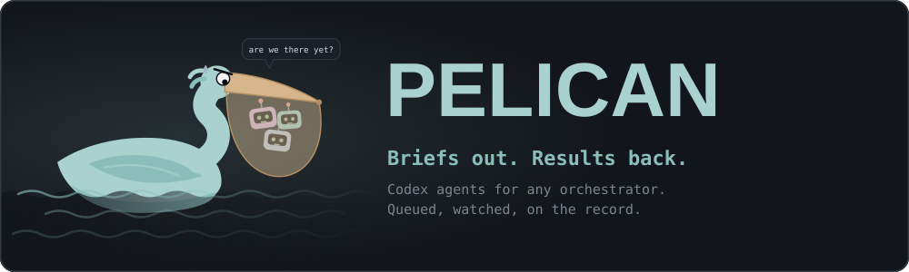

<p align="center">
  
</p>

**Pelican is how one agent runs other agents.** A coding agent (Claude Code,
another Codex, a script) hands Pelican a brief, and Pelican runs it as a Codex
agent: it queues it, keeps it from colliding with the others, passes its
questions back to the agent that spawned it, and returns what it produced.

The agent that calls Pelican is the _orchestrator_. Pelican has none of its
own and no web page. A person sets it up once and, if they like, watches.

```text
      An orchestrating agent (Claude Code, a script, another Codex)
               │              ▲
         briefs │              │ questions, results
               ▼              │
      ┌──────────────────────────────────┐
      │ Pelican                          │
      │ queue · file claims · journal    │
      └──────────────────────────────────┘
               │              ▲
               ▼              │
      Codex agents, each in your project’s folder
```

## What the orchestrating agent gets

- **Spawn and move on.** `spawn` returns an id at once. Agents run in parallel
  up to a per-project limit, and the rest queue.
- **Results it can use.** Ask for structured JSON with a `resultSchema`.
  Pelican validates it and sends the agent back once to fix it; an agent that
  still does not match fails, with the reason.
- **Questions come back.** An agent that needs a decision asks the
  orchestrator that spawned it, and waits. `wait` returns early with the
  question; the orchestrator answers and the agent carries on.
- **No collisions.** Each agent reserves the paths it owns. Agents that claim
  the same files take turns; read-only agents claim nothing.
- **Steering.** Message a running agent, or resume a finished one with
  corrections or review findings, in the same conversation.
- **A record.** Every assignment, command, edit, message, question and report
  is kept for seven days and can be read back.
- **Wake-ups without polling.** `pelican watch` prints one line when something
  needs the orchestrator, so a line monitor (Claude Code's Monitor tool) can
  wake the agent when an agent asks, finishes or goes quiet.

## The loop

1. **Spawn** each piece of work with a complete brief.
2. **Wait.** It returns `done`, `question` or `timeout` with each agent's status,
   result and open questions. Call it again to keep waiting.
3. **Answer** any question, then wait again.
4. **Read the result and check it.** A finished agent is a claim, not proof:
   verify what matters, or spawn a read-only reviewer.
5. **Resume** the same agent with corrections, or spawn the next piece.

A brief is the agent's whole context. Say the goal, the files it owns, how to
check its work and what to report:

```json
{
  "name": "Fix the flaky login test",
  "prompt": "Find why test/login.test.js fails one run in ten and fix it. You own test/login.test.js and src/session.js. Run `npm test` three times; report the cause, the change and the three results.",
  "resources": ["test/login.test.js", "src/session.js"],
  "resultSchema": {
    "type": "object",
    "properties": {
      "cause": { "type": "string" },
      "fixed": { "type": "boolean" }
    },
    "required": ["cause", "fixed"]
  }
}
```

Every operation is both an MCP tool and a CLI command, with the same results:

| MCP tool                         | CLI                      | What it does                                          |
| -------------------------------- | ------------------------ | ----------------------------------------------------- |
| `pelican_spawn`, `pelican_batch` | `pelican spawn`, `batch` | Start one agent, or several that depend on each other |
| `pelican_wait`                   | `pelican wait <id>`      | Wait for agents to finish or ask something            |
| `pelican_answer`                 | `pelican answer <id> …`  | Answer a question or an approval                      |
| `pelican_message`                | `pelican message <id> …` | Steer a running agent, or queue a follow-up           |
| `pelican_resume`                 | `pelican resume <id>`    | Give a finished agent its next assignment             |
| `pelican_get`, `pelican_list`    | `pelican get`, `list`    | One agent in full, or all of them                     |
| `pelican_tail`, `pelican_events` | `pelican tail`, `events` | What an agent, or the workspace, has done             |
| `pelican_stop`                   | `pelican stop <id>`      | Stop one agent, or all; its changes stay              |
| `pelican_note`                   | `pelican note "…"`       | Tell the people watching what you are doing and why   |
| `pelican_runs_start` and friends | `pelican run <script>`   | Run a workflow script that drives many agents         |

For scripts, `pelican wait` exits 0 when done, 2 on a timeout and 3 when an
agent is waiting for an answer. `--json` prints the raw result.

## Workflows

A job that takes many agents (an owner and a fresh reviewer for each item, say)
can be a script instead of a hand-driven loop. The service runs it as the
orchestrator that started it, so it outlives that agent's session. Scripts
written for Claude Code's workflow runner port with few changes.

```js
export const meta = {
  name: "review-change",
  description:
    "Two read-only reviewers look at the change; findings are merged",
  phases: [{ title: "Review" }],
};
const FINDINGS = {
  type: "object",
  properties: { findings: { type: "array", items: { type: "string" } } },
  required: ["findings"],
};
phase("Review");
const reviews = await parallel(
  ["correctness", "tests"].map(
    (lens) => () =>
      agent(`Review the uncommitted change for ${lens}. Do not edit files.`, {
        label: `review:${lens}`,
        schema: FINDINGS,
        resources: [],
      }),
  ),
);
return reviews.filter(Boolean).flatMap((r) => r.findings);
```

Start it with `pelican run review.js --as lead --wait` (`pelican_runs_start`
over MCP). In a script, `agent(prompt, opts)` starts an agent and waits for
it, and returns its validated result, `{ summary, report }` without a schema,
or `null` if the agent fails. `parallel(thunks)` and `pipeline(items, ...stages)`
run many, `phase(title)` and `log(...)` narrate, and `args` holds `--args`.
Scripts have no `import`, `require`, `process` or files. Give each parallel
agent its own `resources`, or they take turns.

`pelican run --resume <run>` runs the script again after a stop, a restart or
an edit. Calls that already completed (same prompt, schema and resources)
return their earlier results at once, and only new or changed calls start
agents. `pelican runs`, `run-status --follow`, `run-stop` and `run-wait`
follow and control runs. More scripts are in [`examples/`](examples).

## Set it up

A person does this once. You need [Node.js](https://nodejs.org) 24 or newer
and the Codex CLI; agents use your ChatGPT sign-in.

```powershell
npm install
npm link                          # puts `pelican` on your PATH
pelican login                     # sign in to ChatGPT, once (this one needs you)
pelican workspace add E:\GitHub\my-project
pelican doctor                    # checks that everything is in place
```

A _workspace_ is a folder Pelican may work in, with its own queue and
settings.

### Connect the agent

Register Pelican with the agent's MCP client, or just hand the agent the repo.

**Register it.** `pelican mcp` is an MCP server over stdio, so any MCP client
can run it. For example, with Claude Code:

```powershell
# Example for Claude Code. Other MCP clients take the same command: `pelican mcp`.
claude mcp add pelican -e PELICAN_AS=lead -- pelican mcp
```

`PELICAN_AS` is the name the agent is known by: its agents' questions come
back to that name.

**Or hand it the repo.** An agent with a shell needs no MCP setup: it can use
the `pelican` command directly, naming itself with `--as <name>` (or
`PELICAN_AS`). Tell it something like:

```text
Pelican is cloned at <path>. Read its README, set it up (npm install,
npm link, pelican doctor) and use it to run Codex agents for this work.
I will run `pelican login` myself.
```

### Tell the agent how to use it

Add this to the agent's `CLAUDE.md` or `AGENTS.md`:

```md
## Delegating to Codex agents (Pelican)

- Run self-contained work as Codex agents with the `pelican_*` tools. You are
  the orchestrator: your agents' questions come back to you.
- Write the brief like a handover: the goal, the files the agent owns
  (`resources`), how to check its work, and what to report. Add a
  `resultSchema` when you will use the result.
- Give agents that run together separate `resources`. Use `[]` for read-only
  work such as reviews.
- Call `pelican_wait`, answer any question with `pelican_answer`, then read
  the result. A finished agent is a claim, not proof: check what matters.
- Use `pelican_note` to say what you are doing, for the people watching.
```

## For the people watching

`pelican` opens a full-screen menu: every orchestrator, agent, workflow and
workspace, live, with each agent's whole conversation (its commands, edits,
questions and result) in colour. It needs a terminal at least 100 × 28. A
person can answer a question, message an agent or stop it from there, and
`pelican watch --as lead` gives the same news as one line each. CLI output is
coloured at a terminal and plain text when piped.

## Good to know

- **Agents work in Codex auto mode.** They write freely inside the workspace;
  anything that leaves the sandbox goes to Codex's automatic reviewer. Each
  workspace has a switch for network access.
- **Several orchestrators can share a workspace.** Each agent's questions wait
  for its owner, and directing another's agent takes an explicit takeover.
- **There are no budgets.** Agents run until their work ends or someone stops
  one.
- **Pelican runs only when needed.** The first call starts it, and it exits a
  few minutes after nothing is running or asked for.

## An independent project

Pelican is an independent project, not affiliated with or endorsed by OpenAI
or Anthropic. It works alongside their tools, so it names them: Codex and
ChatGPT are OpenAI's, and Claude and Claude Code are Anthropic's.

It runs the official Codex CLI with your own sign-in, on your own machine, so
treat it like your own Codex: keep the sign-in yours, and keep Pelican to your
own machine, which is the only place it listens.

## More

- `pelican help` lists every command, and `pelican help <command>` shows its
  options. Each MCP tool describes its own parameters.
- Settings are environment variables, listed in [`.env.example`](.env.example).
  State (the journal, the sign-in, the access token) lives in `.pelican/`.
- Every operation is defined once, in [`src/api.js`](src/api.js), and offered
  the same way over the CLI, MCP, a loopback HTTP RPC (`POST /api/rpc`, with
  the token from `.pelican/token`) and Node (`src/client.js`).

To work on Pelican itself:

```powershell
npm test         # the offline suite, with fake Codex workers
npm run check    # syntax-checks every script
npm run smoke    # live: runs one real agent (uses your allowance)
```
